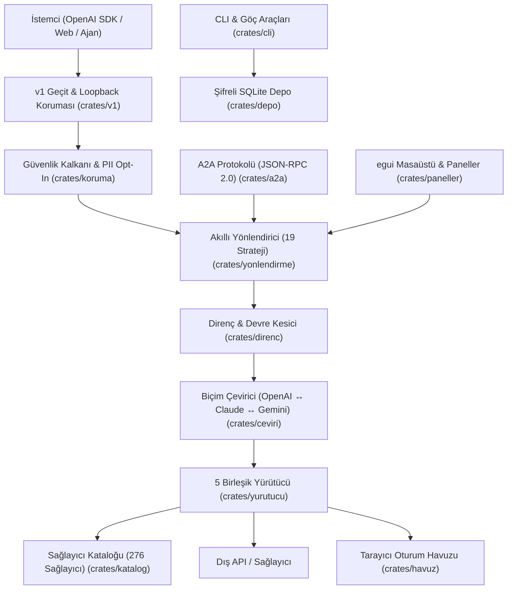

# Kervan Mimari ve Sistem Tasarımı

Bu belge, Kervan'ın modüler yapısını, sandık (crate) topolojisini ve OmniRoute aktarımından türetilen çekirdek mimari bileşenlerini açıklar.

## 1. Çalışma Alanı (Workspace) Topolojisi
Kervan, bağımsız sorumluluk ilkesine dayanan 20 sandıktan oluşur. altin-kapi kuralları gereği her sandık kesin olarak **en fazla 1.500 kod satırıdır**.

| Sandık | Görev ve Sorumluluk |
|---|---|
| `kervan` | Çekirdek orkestrasyon ve sunucu giriş noktası |
| `kervan-v1` | Axum tabanlı OpenAI uyumlu REST API uçları ve loopback koruması |
| `kervan-ceviri` | OpenAI, Claude ve Gemini veri modelleri ve SSE akış parçacığı çeviricisi |
| `kervan-yonlendirme` | 19 kanonik kombo stratejisi, anlamsal önbellek ve belirteç kovası hız sınırlayıcı |
| `kervan-direnc` | Devre kesici (Circuit Breaker), soğuma takipçisi ve model kilitleme |
| `kervan-katalog` | 276 sağlayıcı ve yüzlerce modelin statik gömülü veri kataloğu |
| `kervan-yurutucu` | 5 birleşik yürütücü (REST, Claude, Gemini, Tarayıcı, OAuth) |
| `kervan-depo` | 193 SQL göçü, 134 tablo altın şeması, AES-256-GCM + scrypt şifreleme ve sıcak yedekleme |
| `kervan-a2a` | A2A v0.3 protokolü, JSON-RPC 2.0 görev yönetimi ve ajan kartı keşfi |
| `kervan-koruma` | Sert Kural #20 uyumlu PII maskeleme, API anahtarı gizleme ve enjeksiyon kalkanı |
| `kervan-paneller` | Modüler egui masaüstü panelleri (Gösterge, Model Yönetimi, Güvenlik) |
| `kervan-cli` | `kervan goc` (kuru koşu varsayılan), `kervan yedekle`, `kervan dogrula` araçları |
| `kervan-mcp` | Model Context Protocol JSON-RPC 2.0 araç listeleme ve yürütme |
| `kervan-havuz` | Yalıtılmış oturum ve tarayıcı profil havuzu |
| `kervan-tarayici` | Tarayıcı otomasyonu ve geckodriver sürücüsü |
| `kervan-saglayici` | Web sağlayıcı mantığı ve insan kapısı tetikleyicileri |
| `kervan-akis` | Ağ akışları ve SSE dağıtımı |
| `kervan-akis-gui` | Akış görselleştirmesi |
| `kervan-sunucu` | WebSocket ve arka plan sunucusu |
| `kervan-gui` | egui uygulama penceresi ve WGPU işleme |

## 2. Sert Kurallar Uyumu (OmniRoute 23 Kuralı)
1. **Sert Kural #15 & #17:** Loopback koruması (`127.0.0.1` veya `::1`). Yalnızca yerel istekler kabul edilir.
2. **Sert Kural #20:** PII maskeleme varsayılan KAPALIDIR (yalnızca açık opt-in ile aktifleşir).
3. **Sert Kural #12:** İstemciye ham SQLite hatası veya çağrı yığını sızdırılmaz; tüm hatalar arındırılır (`GuvenlikKalkani`).
4. **Sert Kural §5-4:** Veritabanı göçlerinde kuru koşu (dry-run) varsayılandır. Gerçek göç `--uygula` gerektirir.
